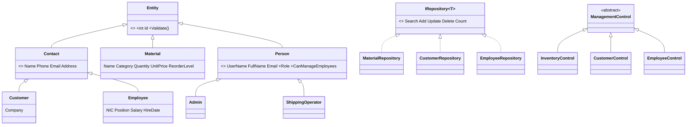

# WareHouseApp – report notes (D2 starting point)

Rewrite these in your own words, add screenshots, and record the video (D3).

## Problem statement
Small warehouses track stock, customers and staff on paper or in spreadsheets, causing stock-outs, duplicate records and no access control. WareHouseApp is a Windows Forms desktop system that keeps all of this in one SQL Server database behind a login.

## Requirements
- Users: warehouse admin and shipping operators.
- Sign up & login (salted PBKDF2 hashes; default admin `admin` / `admin123`, created on first run).
- Inventory CRUD + search, reorder level, low-stock alerts on the home dashboard.
- Customer CRUD + search.
- Employee CRUD + search (Admin only – role based access).
- Validation + exception handling everywhere; every feature persisted in the database.

## Design
Layered architecture: **UI (Forms/UserControls) → Services (AuthService) → Repositories → Database (ADO.NET)**.

OOP concepts: abstraction (Entity, Person, ManagementControl), inheritance, polymorphism (Role/CanManageEmployees overrides, IRepository, template-method screens), encapsulation (Material.Quantity setter rule, private DB access), custom exceptions (`ValidationException`, `AuthenticationException`, `DataAccessException`), factory method (`Person.Create`).

Database tables: Users, Materials, Customers, Employees (created automatically by `Database.Initialize`).

## Version control
Git repository already in the project folder (branches Designing / master). Commit per feature, e.g. "Add DB layer", "Add sign up", "Inventory CRUD", "Customer CRUD", "Employee CRUD".

## Personal reflection / future work (prompts)
Template-method base class saved a lot of duplicate UI code; the starter's missing resource files and hard-coded login were pain points. Future: stock movement history, orders/shipping, reports/export, password change screen, unit tests, multi-language (Language button in the starter).
